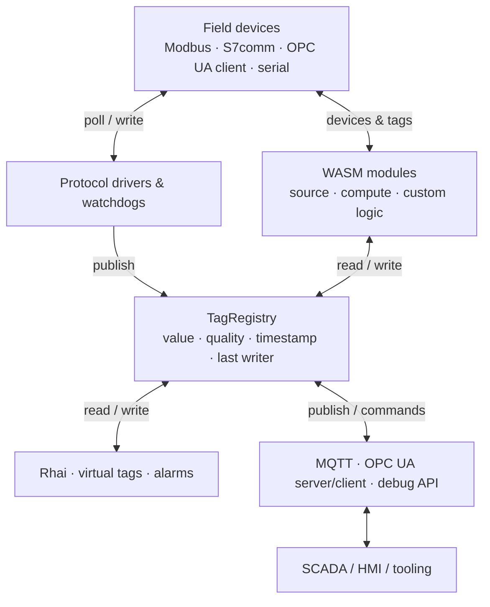

# Architecture Overview & Data Flow

## System Subsystems

Prism is a single core with tooling and clients around it:

1. **Core Runtime (Rust):** protocol drivers with watchdogs, the lock-free `TagRegistry`, embedded Rhai scripting, virtual tags, the WASM extension surface (`source`/`compute`/`ml` and custom user modules), alarms, MQTT and the OPC UA server/client, and the licensing state machine.
2. **Bench & maintenance tooling (Rust binaries), shipped with every instance:** `prism-sim` simulates the field without hardware, `prism-dbg` debugs transports and live tags, `prism-scan` discovers field devices, `prism-sniff` observes and records bus traffic, `prism-devtools` scaffolds instances and generates/validates configs. On Windows the binaries carry the `.exe` suffix; on Linux/macOS they do not (`devtools/simulator/prism-sim`, `devtools/debugger/prism-dbg`, `devtools/scanner/prism-scan`, `devtools/sniffer/prism-sniff`, `devtools/tooling/prism-devtools`). See `03_tooling/01_BENCH_TOOLS.md`.
3. **Integration surface (external by design):** the core draws no UI; a project connects through independent paths, alone or combined:
   - **OPC UA** — the server exposes the tag registry as an address space (`config/02_northbound/02_opc_server/`), while `protocol = "opcua"` devices are clients of external servers (`02_communication/03_OPC_UA.md`);
   - **MQTT** — customizable channel contracts: every channel is a role (`telemetry`, `command`, `ack`, `alarm`, `event`, `control`) plus an arbitrary topic and payload template; the default set is materialized into the instance by `prism-devtools generate mqtt` (§3);
   - **WASM** — modules for whatever the fixed paths do not cover: SCADA-side logic, reports, ML, protocol adapters (see the WASM note above); declarative Excel reports have their own host (`05_wasm/04_REPORTS.md`);
   Project-specific panels, reports and integrations live in `user/` and are never read by the core.



**WASM is the universal extension surface, not a driver-only slot.** Anything
that can be programmed can be attached as a module: a `source` module that
owns field devices and publishes their tags, a `compute` module that consumes
tags which already exist, a protocol adapter, an ML inference step, SCADA-side
logic — the platform does not prescribe what a module may do, because no fixed
list can cover every task. The `source`/`compute` distinction only states which
side of the tag-ownership boundary the module is on; inside that boundary the
user is free to structure the config as the task requires. ML inference is a
separate plugin type with its own ABI (`prism:ml@0.1`, `05_wasm/03_ML.md`):
it exports `infer(features)` and has no tag access at all — the host assembles
the feature vector from `snapshot`/`history` and runs inference off the control
loop. The only contract is
the tag registry: modules read and write tags through the same arbitration path
as built-in writers, and everything a module owns or touches is declared in its
config — there are no black boxes. Vendored products built on the platform
(e.g. control-loop modules) are ordinary WASM modules with their own tooling,
shipped and versioned separately from the core. See
`05_wasm/01_PLUGIN_SDK.md`, `05_wasm/02_DEVICE_DRIVERS.md` and
`05_wasm/03_ML.md`.

The bench utilities (`prism-sim`, `prism-dbg`, `prism-scan`, `prism-sniff`,
`prism-devtools`) ship ready to run in `<project>/devtools/` — they simulate the
field, debug the transports, discover devices, observe the bus and validate
configs without hardware. `prism-sniff` also records traffic to
`devtools/sniffer/log/` on Ctrl+R; see `03_tooling/01_BENCH_TOOLS.md`.

The core itself serves a native debug API (`[debug]`,
default `127.0.0.1:7200`): JSON Lines with the simulator Control API protocol
(`list`/`get`/`set`/`stats`, strict value validation), so `prism-dbg` can observe
and write tags without MQTT, OPC UA or the simulator. Writes go through the
same arbitration point as every other source (`TagRegistry::publish`, see §2).

The engineering override (`force`/`freeze`/`release`/`release_all`) is a
read-side layer above the arbiter: it replaces what readers see — with the
configured `[debug] override_quality` — while real samples keep flowing
underneath, and journals every action to `[debug] audit_path`. `list`/`get`
report the effective value and the active `forced` value.
Keys: `01_getting_started/03_APP_CONFIG.md`; usage: `03_tooling/03_DEBUGGER.md`.

---

## 1. Internal Tag Registry (`TagRegistry`)

The internal data bus is built on lock-free 64-byte cacheline-aligned `AtomicTagCell` structures:
- `value: AtomicU64` — 64-bit IEEE-754 float representation stored via atomic load/store with Release/Acquire memory ordering.
- `timestamp_ms: AtomicU64` — Unix epoch millisecond timestamp of the last sample (local receive time; the remote PLC clock is never trusted).
- `quality: AtomicU8` — Status quality flags:
  - `0`: `Uninitialized`
  - `1`: `Good` (valid measured data)
  - `2`: `Bad` (communication loss, sensor wire-break, BCD parsing failure)
  - `3`: `Uncertain` (force override active, fallback preset, or calibration extrapolation)
- `writer: AtomicU8` — id of the last writer (`TagWriter`), used by arbitration (§2) and diagnostics (who wrote the current value).
- Override fields (value, quality, monotonic deadline) — a read-side replacement installed by the debug override layer: readers see it while it is live, stored samples stay untouched.

Every tag is addressed on the bus as `<device>.<tag>` (e.g. `io_controller.pressure_in`, `calculations.pressure_drop`).

Two read-side additions serve time-series workloads (ML features):

- `TagRegistry::snapshot(&[index])` — a **coherent batch read**: all values in
  one pass, retried while any accepted write starts in between (generation
  counter), so a feature vector never mixes two polling cycles;
- **tag history** (`config/01_southbound/06_history/history.toml`) — optional
  in-memory ring buffers per tag (`depth`, `sample_ms` decimation), queried as
  `TagRegistry::history(index, window_ms)`. Only real accepted samples are
  recorded (never force overrides or rejected writes), with quality preserved.
  See `05_wasm/03_ML.md`.

A **granular hot reload** restarts only the changed module's pollers: a device
module edit (`01_southbound/<proto>/<module>/`, `03_wasm/01_source/<module>/`) and
a changed WASM artifact are applied in place, keeping the registry, MQTT, the
OPC UA server and every other device untouched
([`04_logic/01_RHAI.md`](../04_logic/01_RHAI.md) §6). A change that
reshapes the tag registry — or an explicit `r` + Enter / MQTT `control.reload` —
performs a **full reload**, which rebuilds the registry with its state carried
over (`registry::reload`): the last stored value, timestamp and quality of every
tag are captured before the reload and seeded into the new registry, so scripts
never read `NaN` in the reload window and arbitration continues from the same
timestamps. Live sources overwrite the seeds; configured `initial_value`
presets apply only to tags that never held a value, and a force override is not
carried over (the override layer releases its forces on reload).

---

## 2. Tag Write Arbitration (`TagRegistry::publish`)

Writes reach a tag through two paths:

- **Samples** are published straight to the registry: field pollers, scales,
  the virtual tag evaluator and alarm signals.
- **Commands** (operator writes over MQTT/OPC UA, the debug API `set`, Rhai
  `write()`, compute outputs, one-shot alarm writes, `mirror_to`, fail
  presets) queue a write through `AlarmStore`. A physical target is executed
  by its device poller in queue order and reappears in the registry as a
  poller readback; a virtual target is applied by the store immediately.

Every publish passes one entry point:

```rust
TagRegistry::publish(index, writer, value, ts_ms, quality)
```

A command records the authority of its source, so the tie-break below and the
`last_writer` diagnostics name the real writer (a script write is not silently
recorded as an alarm).

Rules:

1. **No writing into the past.** A write whose timestamp is older than the
timestamp already stored in the tag is rejected: a late sample or a delayed
duplicate must not overwrite a fresher value.
2. **Priority tie-break for the same timestamp.** When a write carries the same
timestamp as the stored value, it passes only if its source priority is not
lower than the priority of the current writer (equal priority: the last writer
wins).
3. **A fresher timestamp always passes.** The arbiter is not sticky: once
field polling returns a fresher sample, it wins even over a higher-authority
source that wrote earlier. Telemetry always stays true to the process, and
polling is never blocked forever.

| Priority | Source Authority | `TagWriter` | Written by |
|---|---|---|---|
| 1 (Highest) | Engineering override via the debug channel | `debug` | debug API `set`; the read-side override layer |
| 2 | Safety logic and alarm actions | `safety`, `alarm` | fail-preset writes; alarm transitions (`alarm.*` signals, `[[alarm.write]]` actions) |
| 3 | Compute / control blocks and ML outputs | `control`, `ml` | WASM compute block outputs; ML job outputs |
| 4 | Operator commands (MQTT / OPC UA) | `command` | MQTT, OPC UA server and OPC DA writes |
| 5 | Field polling | `poller` | field readbacks; `mirror_to` |
| 6 (Lowest) | Virtual tags and scripts | `virtual`, `script` | virtual tag evaluation; Rhai `write()` |

Notes:

- The priority decides **same-millisecond collisions between publishes only**;
it is not ownership. Any newer write passes, so a script write is never
"blocked" by an older alarm value — and an alarm action cannot be locked onto
a plant tag against later logic.
- Physical targets are **not** arbitrated here: commands land in the device
write queue and the wire sees the queue order. Keep one logical owner per
plant tag (Rhai/WASM/alarm): see
[`04_logic/01_RHAI.md`](../04_logic/01_RHAI.md), "Write paths and authority".
- Rejected writes are counted (`TagRegistry::rejection_counters()`: into the
past / lost tie-break) and logged at `debug` level, so the reason is traceable.
Each cell remembers its last writer, exposed to diagnostics via
`AtomicTagCell::last_writer()` — the arbiter uses the same metadata.

The engineering override layer (`OverrideLayer`) sits above the arbiter:
it does not publish and never touches stored samples — it replaces what
readers see until released or the `[debug] override_ttl_ms` deadline (see the
debug API note above).

---

## 3. Bidirectional SCADA Contract Isolation

The core ships no operator UI: any SCADA/HMI client — including a project one
under `user/` — communicates through the MQTT channel set from
`config/02_northbound/01_mqtt/` (`channels.toml` or `channels.d/`, payload
templates in `payloads/`).
**Contracts are customizable** — every channel is a role plus an arbitrary
topic and an arbitrary JSON payload template — and the default set covers the
common wire contract:
1. `prism/telemetry` (QoS 0): Batch telemetry JSON payload:
   ```json
   {
     "data": [
       {"ns_name": "io_controller", "name": "pressure_in", "value": 101325.0}
     ],
     "timestamp": 1726000000000
   }
   ```
2. `prism/status` (QoS 0): Binary device feedback and pump/valve operational states:
   ```json
   {"device": "io_controller", "name": "pump_run", "value": true}
   ```
3. `prism/command/set` (QoS 1): Operator action dispatches:
   ```json
   {"ns_name": "io_controller", "name": "pump_run", "value": true}
   ```
4. `prism/command/ack`: Command acknowledgement list
   (`[{"ns_name": "io_controller", "name": "pump_run", "value": true}]`, a
   `disabled: true` item means the control is not writable).
5. `prism/event/alarm/{severity}`: Alarm transitions — the severity is carried
   in the topic, the payload repeats the full alarm (`device`, `tag`, `message`,
   `priority`, `active`, `acknowledged`, `value`, `limit`, `ts`; see
   `04_logic/02_ALARMS.md`).

The default set also includes device failures (`prism/event/fail/{device}`),
status/diagnostic events and control channels (alarm acknowledge,
`clear_alarms`, `reload`, `plugin_confirm`). Any channel can be renamed,
replaced or multiplied — a second telemetry channel with a different payload
is a normal configuration. See `02_communication/02_MQTT.md`.

A namespace is an internal device identity, not necessarily the name the
SCADA should see. The recommended contract exposes a logical asset model:
raw field namespaces stay internal, while computed and operator-facing tags
live under one logical namespace. This can be done today by consolidating
them in a virtual device; when raw tags must stay in their device
namespaces, the planned namespace-projection extension renders the same
registry tag under the logical namespace without duplicating it. See
[`02_communication/02_MQTT.md`](../02_communication/02_MQTT.md).

Forced values are visible on every read path (registry readers, compute,
OPC UA, MQTT telemetry) together with their `[debug] override_quality`, while
the `forced` field of the debug API `list`/`get` marks them for tooling.
