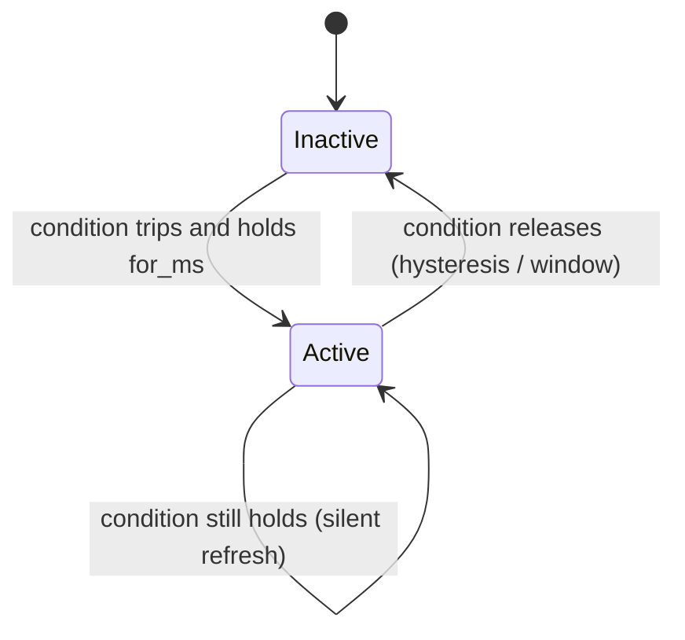

# Alarm Rules (`config/01_southbound/05_alarms/**/*.toml`)

Declarative alarms live **outside the tag definitions**, in their own folder:
every `config/01_southbound/05_alarms/*.toml` file is loaded recursively (sorted by
file name, rules in declaration order) at startup and on hot reload (the legacy
`config/01_southbound/05_alarms/` location keeps working). Alarms are part of the safety
function: configuration mistakes fail fast, and evaluation runs in the
producing task before any best-effort telemetry.

**One rule = one condition = one signalling tag** `alarm.<id>`.
The signal is *held* while the condition is true — `value` is written on
activation, `reset_value` on reset — so Rhai/WASM logic can read it with
`read_bool("alarm.<id>")`. MQTT/CSV events are emitted **on transitions only**.

A rule is evaluated on every fresh value of its source tag (a poller readback
or a virtual-tag evaluation tick). It has two settled states and the
transition between them:



- **Inactive** — the signal holds `reset_value` (uninitialized before the very
  first transition); nothing else happens.
- **Active** — the signal holds `value`; while the condition keeps holding, the
  engine only refreshes the value visible to SCADA — no events, no CSV lines,
  no writes.
- The optional `[alarm.enable]` gate (section 2) decides whether the rule may
  be active at all: while it is false the rule is held inactive (an active one
  resets); with no gate the rule is always enabled.
- A **transition** writes the signal, emits the MQTT event and the CSV history
  line, runs the one-shot `[[alarm.write]]` blocks and calls the `rhai`
  handlers — in this fixed order (section 4).

Related material:

- Rhai API and handlers: `04_logic/01_RHAI.md`
- MQTT topics and acknowledgement: `02_communication/02_MQTT.md`
- Device tags and `[tag.fail]`: `02_communication/01_DEVICES.md`

---

## 1. Rule reference (`[[alarm]]`)

```toml
[[alarm]]
id          = "alarm.oil_temp_high"     # required, must start with "alarm."
tag         = "plc1.oil_temp"    # required, readable source tag
value       = 1.0                       # signal on activation (default 1.0)
reset_value = 0.0                       # signal on reset (default 0.0)
priority    = "critical"                # info | warning | critical | emergency
message     = "Oil: {tag} = {value} C"  # substitutions: {id} {tag} {value} {limit}
for_ms      = 500                       # condition must hold, ms (default 0)
rhai        = "on_oil_temp_high"        # optional name or list of names
```

- `id` is free after the mandatory `alarm.` prefix; it must be unique and must
  not collide with a configured tag. The full id **is** the signalling tag.
- `tag` is the source the condition is bound to. It must exist and be readable
  (`ro` or `rw`; a `wo` tag cannot be a source).
- `value` / `reset_value` accept numbers or bools (bool is stored as 0/1).
- `priority` only routes/displays the MQTT message; it does not affect the
  signal or the actions.
- `for_ms` requires the condition to hold **continuously** before activation
  (anti-chatter): a single false (or unknown) evaluation restarts the timer. Do
  not confuse it with `window_ms` of `rate`/`switching` (which is the
  observation window for derived metrics).

Each rule needs at least one condition block: `[alarm.limit]`, `[alarm.rate]`
or `[alarm.switching]`. When several blocks are present, the rule trips when
**any** of them trips (logical OR), e.g. "out of range OR frozen".
An optional `[alarm.enable]` block gates the rule: it may be active only while
the gate holds (see section 2).

## 2. Condition blocks

### `[alarm.limit]` — static bounds

| Field | Type | Required | Semantics |
|---|---|---|---|
| `min` | number | ○, at least one of `min`/`max` | trips when `v < min` |
| `max` | number | ○, at least one of `min`/`max` | trips when `v > max` |
| `hysteresis` | number ≥ 0 | ○, 0.0 | reset deadband: how far the value must come back before the alarm clears |

```toml
[alarm.limit]
min        = -20.0    # optional; alarm when v < min
max        = 80.0     # optional; alarm when v > max
hysteresis = 2.0      # reset deadband (default 0.0)
```

**Activation** is strictly beyond a bound: `v = max` exactly does not trip.
**Reset** happens on the same side that tripped, with the deadband applied:

- tripped on `min` — clears only at `v >= min + hysteresis`;
- tripped on `max` — clears only at `v <= max - hysteresis`.

With `max = 80.0` and `hysteresis = 2.0`: a reading of `90` trips, `79` keeps
the alarm active (inside the deadband) and only `78` releases it. The deadband
exists so a value wobbling around the bound does not chatter the signal; it is
applied on release only, never on activation.

If both bounds are set and the value crosses to the opposite one while active,
the rule *switches sides* and stays active — no clear + re-trip pair is
emitted; the deadband then guards the other bound.

Boolean sources: values are `0`/`1`, so `min = 1` alarms on `0` and `max = 0`
alarms on `1`.

### `[alarm.rate]` — analog dynamics

```toml
[alarm.rate]
window_ms  = 1000     # observation window, ms (default 1000)
max        = 5.0      # units/s: |last - first| / dt above it alarms ("too fast")
min_change = 0.05     # units: spread (max - min) over the window below it alarms ("frozen")
```

- `max` catches a runaway — a bearing temperature jumping 10 °C in a second;
  the rate is measured between the window endpoints, so with a sparse poller
  the span is the actual time between samples, not the poll period.
- `min_change` catches a dead sensor: a reading that no longer moves — samples
  `42.01, 42.00, 42.02` over the window are a spread of `0.02`, below a
  `min_change = 0.05`.

### `[alarm.switching]` — discrete signals (encoders, PWM)

```toml
[alarm.switching]
window_ms = 1000
min_hz    = 0.5       # edges/s below it alarms ("stuck")
max_hz    = 200.0     # edges/s above it alarms ("chatter")
min_duty  = 0.05      # "1" fraction below it alarms
max_duty  = 0.95      # "1" fraction above it alarms
```

An **edge** is a change between consecutive samples (`0 -> 1` or `1 -> 0`);
**duty** is the time-weighted "1" fraction over the window. The four checks
catch:

- `min_hz` — a signal that stopped switching (encoder, fan tacho, watchdog
  blink);
- `max_hz` — chatter (a bouncing contact flipping far too often);
- `min_duty` / `max_duty` — a PWM output stuck low or high (e.g. a bypass
  valve held open).

Make sure the tag is updated fast enough to see the switching (poll period or
virtual-tag tick).

### Window readiness and unknown data

- "Too fast" checks (`rate.max`, `switching.max_hz`) evaluate as soon as two
  samples are available.
- "Too slow / frozen / duty" checks (`rate.min_change`, `switching.min_hz`,
  `*_duty`) require a window that actually covers `window_ms`; until then the
  verdict is *unknown*.
- While the verdict is unknown **no transition may happen**: an active alarm is
  not cleared (no evidence) and a pending `for_ms` hold is dropped
  ("continuously held" is no longer proven).
- On `Bad` quality / link loss the windows are reset, but an active signal is
  kept: it is the last known state of the process.

### `[alarm.enable]` — rule gate (not a condition)

An optional **enable condition**: the rule may be active only while the gate
holds. Without the block the rule is always enabled. Exactly one form:

```toml
[alarm.enable]
tag = "io_controller.pump_run"                      # tag form: non-zero = enabled
# expression = 'read("io_controller.flow") > 1.0'   # Rhai expression
# script_func = "stand_is_running"                  # no-argument Rhai function
```

- `tag` — any readable tag (`ro`/`rw`); non-zero is enabled, zero is disabled.
  The **effective** value is read, so the debug force layer can drive a gate
  like any other tag.
- `expression` / `script_func` are evaluated with the script context
  (`read`, `read_bool`, ...) like a virtual-tag formula; a non-zero result is
  enabled — negate inside the expression when needed.
- While the gate is **false** the rule is held inactive: the condition is not
  evaluated, and an *active* rule resets — a normal reset transition (signal,
  event, CSV, `off` writes and `rhai` handlers with `active = false`).
  Gated-out time does not count as evidence: `for_ms` holds and
  `rate`/`switching` windows restart when the gate returns.
- While the gate is **unknown** (tag quality `bad`/`uninitialized`, expression
  error, or the script engine is unavailable) the rule is frozen: no
  transitions at all, an active alarm is kept — the same "no evidence" rule as
  for underfilled windows.

## 3. Signal tags

`alarm.<id>` lives in the tag registry for user logic:

- Rhai: `read("alarm.oil_temp_high")`, `read_bool(...)`, `read_quality(...)`;
- WASM modules: regular tag bindings;
- before the first transition the tag is uninitialized
  (`read_bool` returns `false`, `read_quality` returns `"uninitialized"`).

Signal tags are **not** published to MQTT/OPC, but they **do** count toward
the license tag inventory: one `alarm.<id>` point per rule (like field I/O,
virtual and WASM tags — see `../06_operations/01_LICENSING.md` §1). The signal
is owned by the engine: logic writes (`write`, commands) into `alarm.*` are
ignored, while the debug force layer
(`../01_getting_started/03_APP_CONFIG.md`, `[debug]`) can still override any
tag for testing.

If the user logic needs a latched alarm with no condition, use the manual
Rhai functions instead (see section 7).

## 4. Actions on transitions

The fixed order is: **signal → event (MQTT + CSV) → held writes → Rhai
handlers**. An error in one Rhai function is logged; the remaining actions
still run.

### `[[alarm.write]]` — held interlock write (the block repeats)

```toml
[[alarm.write]]
tag = "plc1.oil_pump_start"   # must exist and be writable
on  = 0                              # value held while the alarm is active
off = 1                              # value written on reset; omit to keep the last value
hold = true                          # default: interlock; false restores one-shot pulses

[[alarm.write]]                      # the block repeats: one per target tag
tag = "plc1.oil_light"
on  = 1                              # reset write skipped for this target
```

To change several tags on the same transition, declare one block per target —
all of them run in declaration order; Rhai handlers are not required for this.

Alarm writes are **not advisory**. With `hold = true` (the default):

- the `on` value is written on activation and **held** while the rule is
  active; every reader sees it;
- the alarm tier is above everything else, including `prism-dbg` force/freeze:
  commands, scripts, compute blocks, Rhai and debug overrides are refused while
  the hold is active (`tag is held by active alarm '<id>'`);
- the signal tag (`alarm.<id>`) is held too, so a debugger cannot hide a live
  alarm;
- on reset the optional `off` value is written and the hold is released; only
  then can the operator change the output again.
- several rules may guard the same tag: each owner is tracked, the first in
  rule-id order defines the value, and releasing it hands the hold to the next
  owner.

`hold = false` keeps the historical one-shot behaviour for pulse commands. It
is suitable only for momentary actions (horn, acknowledge lamp), never for
pump/valve/frequency outputs.

### `rhai` — user handlers

```toml
rhai = ["on_oil_temp_high", "notify_hmi"]
```

Each function is called on both transitions with a single map argument:

```rhai
fn on_oil_temp_high(ctx) {
    log_warn(`ALARM ${ctx.id}: ${ctx.tag} = ${ctx.value} (active=${ctx.active})`);
    if ctx.active {
        write("plc1.oil_pump_start", 0);
    } else if !read_bool("alarm.oil_temp_low") {
        write("plc1.oil_pump_start", 1);
    }
}
```

`ctx` fields: `id`, `tag` (full source tag id), `value` (measured value),
`active` (bool), `priority` (lowercase string). Handlers run under the regular
script budget/deadline and may use `read`/`write`/`log_*`.

## 5. MQTT, history and acknowledgement

Transitions publish to `prism/event/alarm/{severity}` (severity is lowercase,
all levels are published; `{priority}` is a synonym filled with the same value —
see the per-channel placeholder map in `../02_communication/02_MQTT.md` §2).
The payload carries `device`, `tag`, `alarm_type` (the rule id for catalog
rules; ack updates keep it, manual alarms use the generic `alarm`), `active`,
`value`, `message`, `priority`, `acknowledged`, `ts`.
Transitions are also appended to the CSV alarm history
(see `../01_getting_started/03_APP_CONFIG.md`).

Acknowledgement: the client publishes `{"ack": true}` to the `alarm_ack`
topic, which **must** contain `{namespace}` and `{name}` placeholders
(e.g. `prism/event/alarm/ack/{namespace}/{name}`) — the ack is keyed by the
alarm's source tag and acknowledges **every** active unacknowledged alarm of
that tag. An optional `"alarm_type": "<rule id>"` narrows the ack to a
single rule. A flat `alarm_ack` topic is rejected with a WARN.

Delivery guarantees: the held signal, the store state and the CSV history are
written locally first, so a broker outage never loses process state. On every
broker (re)connect — and after a local event-queue overflow — the gateway
re-announces the current state: active alarms and fails (keeping the rule id,
with `"resync": true`) plus the clears recorded since the previous sync, so a
SCADA converges even if it missed messages. `alarm_heartbeat_ms` /
`fail_heartbeat_ms` additionally refresh active state periodically, and
`critical_heartbeat_ms` gives critical/emergency alarms a dedicated (usually
faster) cadence — with it set, the general alarm heartbeat skips those two
priorities (no double heartbeats).

Alarm state lives in memory: after a restart an active alarm re-announces
(unacknowledged) at its first evaluation; the CSV history is preserved.

## 6. Validation

Configuration is validated fail-fast at startup, on hot reload and with
`--check-config`:

- structural: id prefix/uniqueness, at least one condition block, valid bounds
  (`min < max`, `hysteresis >= 0`, `window_ms > 0`, finite values, duty within
  0..=1), exactly one `[alarm.enable]` form when present, unknown fields are
  rejected (`[limit]` instead of `[alarm.limit]` is a parse error, not a silent
  no-op);
- references: the source exists and is readable; the optional enable tag
  exists and is readable; every `write` target exists and is writable; the
  signal id does not collide with a configured tag;
- warnings: a source tag that is updated neither by polling nor by evaluation
  (the rule fires only when logic writes it), and an enable tag in the same
  position (the gate keeps the rule frozen until it is written).

A broken rule stops the reload: the process keeps the previous configuration
and waits for the file to be fixed.

## 7. Manual (script) alarms vs catalog rules

- Catalog rules are declared in TOML and produce the held signal `alarm.<id>`.
- `raise_alarm(tag, priority, message)` / `clear_alarm(tag)` from Rhai are
  **manual latched** alarms on a regular tag (journal/SCADA state); they have
  no `alarm.<id>` signal and live until cleared. `clear_all_alarms()` resets
  all alarm states and the history.

## 8. Full example

```toml
# config/01_southbound/05_alarms/01_temperature.toml

[[alarm]]
id          = "alarm.oil_temp_high"
tag         = "plc1.oil_temperature"   # source of the condition
value       = 1.0                             # signal while active
reset_value = 0.0                             # signal after reset
priority    = "critical"                      # routes the MQTT event
message     = "Oil: {tag} = {value} C (limit {limit})"
for_ms      = 500                             # must stay out of range 500 ms
rhai        = "on_oil_temp_high"              # called on both transitions

[[alarm.write]]
tag = "plc1.oil_pump_start"            # stop the pump on trip
on  = 0
off = 1                                       # start it again after reset

[[alarm.write]]
tag = "plc1.alarm_light"               # beacon: on trip only
on  = 1                                       # no `off`: reset writes nothing

[alarm.limit]
min        = -20.0                            # trips below -20
max        = 80.0                             # trips above 80
hysteresis = 2.0                              # clears at >= -18 / <= 78
```

Step by step: a reading of `81` held for 500 ms trips the rule — the signal
`alarm.oil_temp_high` goes to 1, a `critical` event and a CSV line are emitted,
the pump is stopped, the beacon lights up and `on_oil_temp_high` runs. At
`79` the rule stays active (the deadband covers the bound); at `78` it resets:
the signal returns to 0, the pump is started again (`off = 1`) and the beacon
is left alone (no `off`). The same pair of bounds covers both directions — the
low side trips below −20 and clears at −18.

The same source can drive several rules (for example a high and a low bound):
slot order in the store follows the catalog order, and the acknowledgement
contract (`device.tag`) stays the same.

## 9. Sensor diagnostics: what moved where

The former inline `[[device.tag.fault_scenario]]` block was removed. Its cases
map onto the surviving mechanisms — note that the **link-loss hold value was
never part of `fault_scenario`**, it is the `[tag.fail]` block
(see `../02_communication/01_DEVICES.md`):

| Old `fault_scenario` | Now |
|---|---|
| `wire_break` (NaN / ±Inf value) | a non-finite reading from a healthy link is classified as `Bad` quality in the poller; `[tag.fail]` decides what to do (`last_known` hold / `preset` `safe_value` / synthetic `alarm`) |
| `overrange` | `[alarm.limit]` `min` / `max` (+ `hysteresis`) |
| `frozen_value` | `[alarm.rate] min_change` (+ `window_ms`) |
| `rate_of_change` | `[alarm.rate] max`, units/s |
| `action = "clamp"` / `safe_output` of a control loop | the loop module decides its own reaction (the output owner is the logic — Rhai/WASM/compute module) |

`[tag.fail]` (kept, unchanged): `fail_strategy = "last_known" | "preset" | "nan" | "alarm"`,
`safe_value`, `preset_target`, `fail_message`. `last_known` keeps the last value
and marks the quality `Bad`, `preset` substitutes `safe_value` (`Uncertain`) and
may queue `preset_target`, `nan` publishes no data (`Bad`), `alarm` raises the
synthetic fail alarm in the tag's reserved slot. The directory-wide default is
`[defaults.tag.fail]` (`../02_communication/01_DEVICES.md` §1.4).

---

## 10. Reference project: stand-01

`instances/stand-01` carries an alarm set that covers every condition block,
every check and every action of this chapter, tied to the tags of the
filtration stand:

| File | Rules | Demonstrates |
|---|---|---|
| `01_filter.toml` | `filter_clogged`, `filter_rupture`, `pressure_in_high`, `pressure_spike`, `flow_frozen`, `filter_service_due` | `limit` max/min + `hysteresis`, `for_ms`, `rate.max`, `rate.min_change`, `{value}`/`{limit}` messages, `info`/`warning`/`critical`, writes with and without `off`, a virtual (expression) source, `[alarm.enable]` gates (tag and expression forms) |
| `02_tank.toml` | `tank_level_high`, `tank_level_low`, `tank_temp_high`, `heater_stuck_on`, `pump_chatter` | write `on = 0` without `off` (manual restart), multi-block OR (`limit` + `rate`) in one rule, `rhai` handler list, `emergency`, `switching.max_duty` (PWM bypass) and `switching.max_hz` (chatter) on coils |
| `03_devices.toml` | `flow_meter_fault` | boolean source (`max = 0` alarms on 1), boolean `value`/`reset_value` (stored as 1/0) |
| `04_watchdog.toml` | `watchdog_stuck`, `watchdog_duty_low` | low-side `switching`: `min_hz` ("stopped toggling") and `min_duty` on the self-toggling virtual tag `calculations.watchdog_blink`; freeze or force the tag (`prism-dbg control ...`) to trip, release to clear |
| `scripts/40_interlocks.rhai` | manual `raise_alarm`/`clear_alarm` | script-latched alarm: the pump runs while the flow is below the limit |

`filter_service_due` and `flow_meter_fault` watch the RTU flow meter: on a
bench they need the virtual serial pair of `../03_tooling/02_SIMULATOR.md`.
The other rules run against the Modbus TCP device and are driven directly.

Every declarative transition lands in `data/alarms.csv`, a log line and the MQTT
event channel; the held signal `alarm.<id>` is readable from Rhai/WASM. To
exercise a rule, drive its source tag from the simulator, e.g.
`prism-dbg control set io_controller.tank_level 0.9` (the level-high trip) — the
same tool `watch`es the tag and shows the alarm catalog without a running core.

The enable gates are drivable the same way. `flow_frozen` is gated by
`io_controller.pump_run` (tag form), `filter_clogged` — by
`read("io_controller.flow") > 1.0` (expression form): pin a frozen flow
(`prism-dbg control force io_controller.flow 120`), then toggle the gate —
`force io_controller.pump_run 1` trips `flow_frozen` after the rate window
fills, `0` resets the active alarm immediately although the value is still
frozen, and the rule emits nothing at all while the gate cannot be trusted.
