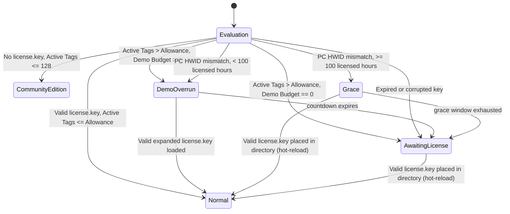

# Licensing Lifecycle & Project Distribution

## Overview
Prism incorporates an asymmetric cryptographic licensing system to verify active tag allowances, machine fingerprints and licensed feature grants.

---

## 1. Key File Location & Tag Accounting

- **Location:** The canonical key is `[license] key_path` from `config/00_core/00_app.toml` (the generated config points to `<instance>/licensing/license.key`). At startup a fixed list of locations is checked once — canonical path, next to the binary, the binary's parent folder, the instance root, `config/`, the working directory, and `licensing/inbox/`. A newer *applicable* key wins by its signed `issued_at`; the chosen file is moved into `licensing/license.key` (the previous different key is archived under `licensing/backup/`). A failed move never blocks startup: the key is validated in place.
- **Discovery is one-shot:** while the canonical key stays valid the runtime does not scan directories again. A moved/deleted/invalid key triggers a new discovery; a new key placed next to the binary while the current one is still valid is picked up on the next restart or after the current key is lost.
- **Tag-quota add-ons:** a signed `*.license.key` in `licensing/addons/` extends a concrete base license. It references `parent_license_id`, carries `extra_tags`, inherits the parent's hardware binding, and is counted only while its parent is the active base license. The effective quota is `base.max_tags + sum(valid add-ons)`; duplicate add-on IDs count once, the newest `issued_at` wins. An add-on is never accepted as a base license.
- **Tag Inventory Scope:** The license limit enforces the total number of active tags calculated at startup — every addressable point counts, whatever its kind:
  - Physical field I/O tags (Modbus TCP/RTU, S7comm, OPC UA client).
  - Virtual calculated points and scratch-pad tags (`01_southbound/04_virtual_tags/**`).
  - WASM module tags: devices declared by device plugins (`03_wasm/01_source/**`) — a module's tags belong to its device and count as their own kind.
  - Alarm signalling tags: one `alarm.<id>` point per declarative rule (readable by scripts/WASM logic; not published to MQTT/OPC).
  - Active script variables and binding tags (`scripts/bindings.toml`).
  - Legacy OPC DA tags mapped via the bridge (`config/02_northbound/03_opc_da_bridge/tags.toml`).
  - *(Note: service tags (`system.*`, `04_logic/03_SERVICE_TAGS.md`) are runtime controls — reload, alarm acknowledgement, maintenance switches, health counters. They are virtual and hardware-free, and they **do not count** toward the quota, neither do the alarm signals of rules bound to them. The same holds for the free/demo tier.)*
  - *(Note: MQTT payload decorators (`[[channel.field]]`) and OPC UA data only decorate an existing tag's message. They create no addressable point (no registry entry, no quality/history, readable only inside the frame), so they do not count toward billable tags; counting stays consistent with "a tag is a field point, a variable or a button's bound tag".)*

---

## 2. Licensing Lifecycle State Machine



### Community Edition (<= 128 Tags)
If no `license.key` is present and active tags do not exceed 128, the gateway boots in `FreeTierOk` mode with the full feature set — every module works, WASM plugins included; the only licensed quantity is the tag quota.

### 60-Minute Demo Overrun Mode
If active tags exceed the licensed allowance (or the 128-tag Community edition limit):
1. A prominent countdown warning banner is displayed in the console and operational logs.
2. The gateway continues normal execution for exactly **60 cumulative minutes**.
3. The demo budget is spent in fixed 10-second ticks and persisted to the state file (`[license] state_path` in `config/00_core/00_app.toml`, resolved against the config dir). Restarting the process does not reset the timer. Deleting or corrupting the state file does **not** grant a fresh 60 minutes: the state is restored from `.bak` if possible, otherwise the runtime enters `AwaitingLicense` with reason `StateTampered`.

### Persistent "Awaiting License" Mode
Once the 60-minute demo countdown reaches zero:
1. Field I/O polling is halted, and WASM compute blocks are suspended.
2. The application remains running and listens for updated license files.
3. Every 3 seconds, the runtime checks for the appearance of an updated `license.key`. Upon detecting a valid file, the runtime automatically resumes field polling without requiring a manual restart.

---

## 3. Interactive License Activation Wizard

Starting with Prism v0.1.0, the gateway features an **Interactive Activation Wizard** that eliminates blind startup crashes and guides administrators through commissioning.

### 3.1. Startup Check
When Prism is launched without a valid `license.key` (or if tag count exceeds the 128-tag Community edition):
1. Prism detects an interactive terminal and presents a startup confirmation prompt:
   ```text
   ===============================================================================
   PRISM GATEWAY STARTUP
   ===============================================================================
   ⚠️  License file was not found at: C:\prism\license.key

   License not found. Do you want to activate a license now? [Y/n] 
   ```
2. **Declining (`n` / `N`):** The process exits gracefully with exit code `0` and a clear explanation, without throwing unhandled panics or error codes.
3. **Accepting (`Y` / Enter):** Automatically launches the guided **License Activation Wizard**.

> **Note:** The wizard can also be invoked manually at any time on an existing installation by executing:
> ```bash
> prism activate
> # or
> prism --activate
> ```

---

### 3.2. Step-by-Step Activation Flow

#### Step 1: Host Machine Identification
The wizard queries the local operating system (Windows `MachineGuid`, BIOS UUID, Motherboard Serial, CPU ID) and generates your permanent **PC Hardware ID (HWID)**:
```text
💻 Host Machine Identity (PC HWID):
   Hardware ID: PC-D059-9313-1EBC-66EA  [OK]
   Hostname:    STAND-PC-01
   Platform:    windows
```

#### Step 2: Licensee & Facility Name
Enter the registered organization or test bench facility:
```text
[1/4] Organization / licensee name (e.g., Acme Corporation):
   > Industrial Filters LLC
```

#### Step 3: Instance Name
Every installation (gateway) is licensed for its own **instance name**
(`[system] instance_name` in `app.toml`). The runtime takes an exclusive
`HWID + instance` lock, so a second copy with the same instance on one machine
refuses to start (`exit code 3`) — one license cannot be multiplied into many
tag quotas by launching extra processes.
```text
[2/4] Application instance name ([system] instance_name in app.toml).
   Each installation/gateway gets its own license with this name;
   two processes with the same instance cannot run on one machine.
   Instance name (default: industrial-stand-01):
   > furnace-01
```

#### Step 4: Tag Quota Allocation
Select the required operational tag quota for your physical and virtual points:
- `[1] Standard Tier` — up to 512 tags
- `[2] Professional Tier` — up to 2048 tags
- `[3] Enterprise Tier` — Unlimited tags
- `[4] Custom tag count`

#### Step 5: License Request Generation & Application
1. The wizard saves an editable `license_request.toml` in the `licensing/`
   folder next to `prism.exe` (the folder is created on demand):
   ```toml
   client = "Industrial Filters LLC"
   instance = "furnace-01"
   hardware_id = "PC-D019-9613-1EBC-66EA"
   requested_tags = 64
   hostname = "STAND-PC-01"
   os = "windows"
   requested_at = 1700000000
   ```
   The request is the single source of truth; the vendor fills in the `[grant]`
   section (tag quota and features) before issuing the key.
2. **Immediate Activation:** If you already have a signed key, you can paste its path or JSON directly into the wizard. The wizard verifies the Ed25519 signature in-memory, writes `license.key`, and immediately boots Prism.
3. If awaiting delivery from the software vendor, send `license_request.toml` to your vendor and place the resulting `license.key` next to `prism.exe` once received.

### 3.3. User-side License Manager (`prism license`)

The product binary ships with a customer-facing license manager; run it from
the instance directory:

```sh
prism license            # same as `status`
prism license status     # key, terms, and the machine it is bound to
prism license request    # activation wizard (writes licensing/license_request.toml)
```

### 3.4. Licensing Paths

Until the activation server exists, all licensing goes through the
**request → license exchange**:

- the wizard writes `licensing/license_request.toml` (customer, instance, HWID,
  requested quota);
- the vendor issues a signed `license.key` bound to the machine's HWID from the
  request, so a copy on a machine with a different HWID does not run;
- self-service activation on first run and serial batches are intentionally
  **not available** until the activation server arrives.

---

## 4. Grace and Transfer Windows (hardware change)

A hardware change (PC replaced — **HWID mismatch**) is the one
failure the runtime can soften by itself: the license is bound to the machine,
but the stand may keep working while an updated `license.key` is issued. How
much time is granted depends on how long the license has actually served:

- **100 licensed hours reached** — the runtime opens the full **7-day grace
  period** automatically, without contacting customer support and without any
  activation step on site. The stand keeps working with all tags.
- **Below 100 licensed hours** — only a **60-minute transfer window** opens:
  a key copied onto a stand that never did the work is a migration, not a
  transfer, and must not earn a week.
- **An expired key grants no grace.** Licenses are perpetual: an expired key is
  a broken delivery, and only a replacement key restores operation.

The runtime keeps a licensed-uptime ledger (`.license_uptime.bin`, internal
state next to the demo timer); hours accumulate only while the process runs
**under an accepted key** — powered-off time counts nothing, and free-tier or
demo operation is never credited. The grace window itself lives in
`.license_grace.bin` next to it, bound to the machine and usable **once**:

- a burned, corrupted or copied-from-another-machine journal does not extend
  or restart the window: after it, the runtime blocks and keeps requesting a
  valid key;
- the states are checksum-protected with monotonic timestamps, so moving the
  system clock back neither restarts nor burns the period;
- the license file itself is never modified; replacing it with a valid key at
  any moment — during or after the window — restores normal operation
  immediately.

Operators see a countdown banner on start (7-day grace or 60-minute transfer)
and a warning in the log; neither window changes the licensed tag quota.

---

## 5. What a release contains

Prism is distributed as a portable folder per platform in the public release
repository — `prism-win/`, `prism-linux/`, `prism-macos/` — and as
`prism-<version>-<os>.zip` attached to a GitHub release.

```text
prism-<os>/
├── README-RU.md                     # entry point (Russian)
├── README-EN.md                     # entry point (English)
├── LICENSE                          # Prism Community edition license
├── THIRD_PARTY_NOTICES.md           # third-party license texts
├── SHA256SUMS                       # checksums of every shipped file
├── docs/                            # numbered user guides
├── examples/tour/                   # complete project, runs without hardware
└── prism/                           # the platform instance
    ├── prism(.exe)                  # main program
    ├── config/                      # empty skeleton, commented TOML examples
    ├── scripts/                     # Rhai scripts and bindings.toml
    ├── devtools/
    │   ├── simulator/prism-sim(.exe)    # simulated field
    │   ├── debugger/prism-dbg(.exe)     # live tags, diagnostics, log screens
    │   ├── scanner/prism-scan(.exe)     # read-only device discovery
    │   ├── sniffer/prism-sniff(.exe)    # bus sniffer / relay
    │   └── tooling/prism-devtools(.exe) # generators, validators, tag reports
    ├── udev/                         # Linux only: persistent RS-485 port names
    └── data/ logs/ licensing/ …      # runtime folders
```

**Community edition.** The same binary works without a license up to **128 tags** — the
try-out mode; nothing to install or activate, and no capability is held back:
field protocols, MQTT/OPC UA, alarms, scripting and WASM modules all run. A
license key only raises the tag quota (see §2 and §3). Within the Community
allowance startup is silent: there is no activation prompt and no missing-key
warning. The wizard is offered only when the project exceeds the limit or
an existing license file is rejected.

**First run** (`README-RU.md` for Russian, `README-EN.md` for English). The
`prism/config/` folder ships as an empty, commented skeleton: the user edits it
instead of starting from nothing. The first launch unfolds the runtime folders
and writes whatever is missing — the same bootstrap that `prism init` performs
explicitly — and never overwrites existing files. Verify the unpacked bundle
with `sha256sum -c SHA256SUMS` before the first run.

```sh
prism --check-config  # first launch: creates the runtime structure, then validates
prism                 # run
```

The bootstrap never overwrites existing files and runs on every start.

**License exchange.** The customer runs `prism license request`; the wizard
writes `licensing/license_request.toml` (company, instance, HWID, quota,
features) and the vendor issues a signed `license.key` — see §3.4.

> **Where `license.key` is looked up.** The canonical path is `[license]
> key_path` (`../licensing/license.key` in generated configs). A one-time
> discovery also checks next to the binary, the binary's parent, the instance
> root, `config/`, the working directory and `licensing/inbox/`. The newest
> applicable key is moved into `licensing/license.key`; the source and any
> archive action are logged (`[License] Moved license.key: … -> …`).
>
> While the canonical key stays valid, directories are not scanned again. A
> moved/deleted/invalid key triggers one new discovery.
>
> **Tag add-ons.** `licensing/addons/*.license.key` files are signed
extensions of a concrete base license, provided by the vendor. The effective
quota is the base limit plus all valid add-ons; `prism license status` prints
the base, add-ons and total.
>
> The chosen source and the candidate list are logged:
> `[License] Paths: key=… (source: licensing|exe_dir|instance_root|config|cwd|…)`.
> When no file is found the log lists every candidate:
> `[License] license.key not found. Place the file in any of these locations: …`.
>
> ### Diagnostics: "Prism does not see the license"
>
> `License file was not found` and `License file REJECTED` are **different cases**:
>
> | Symptom | Cause | What to do |
> |---|---|---|
> | `not found. Searched: …` | the file is in none of the fixed locations | put `license.key` next to the `prism.exe` that actually runs (for the service — next to the service exe, not a shortcut) or into `licensing/` |
> | `REJECTED: … Reason: HardwareMismatch` | the key was issued for another machine | send the vendor `prism --print-hwid` from this machine; they issue a replacement key |
> | `REJECTED: … Reason: InvalidSignature` | the file is damaged or signed by another master key | request the file again; never edit it in a text editor |
>
> Non-ASCII characters in the path are fine: paths go through `PathBuf` and the
> Windows API, the JSON is read as UTF-8, a BOM is stripped.

> Service registration (`prism service install`) is performed by the binary
> itself — no platform service files are shipped in the bundle.
